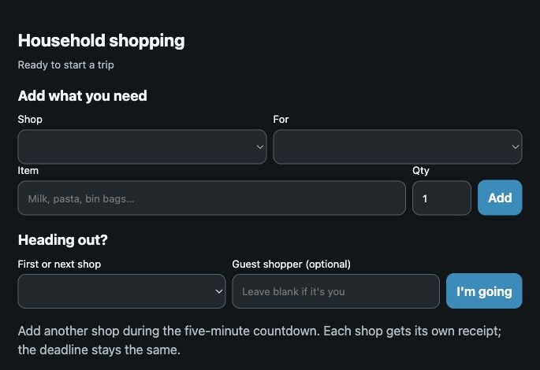

# Household Shopping

Keep one shared shopping list in Home Assistant and print a separate receipt for each store before a trip.

[](https://my.home-assistant.io/redirect/marketplace_repository/?owner=vibribbonee&repository=household-shopping-ha&category=integration)

## Features

- Add items per store or start a trip by tapping a store tag.
- Group stores in a five-minute window and print their lists with loyalty codes.
- Reprint a receipt or undo a trip to restore its items.



## Setup

1. Install from Home Assistant Marketplace and restart Home Assistant.
2. Add **Household Shopping** in **Settings → Devices & services**. Choose a to-do list and an [Epson receipt printer](https://github.com/vibribbonee/ha-epson-receipt-printer). A [Brother label printer](https://github.com/vibribbonee/ha-brother-label-printer), Assist announcements, and Telegram notifications are optional.
3. For the dashboard card, copy [`household-shopping-card.js`](www/household-shopping-card.js) into `/config/www` and register `/local/household-shopping-card.js` as a JavaScript module resource. Add the card and select the shopping sensor.

```yaml
type: custom:household-shopping-card
entity: sensor.household_shopping
```

Use **Manage stores & loyalty cards** to set up stores and receipt barcodes. **Reprint** uses the saved receipt. **Undo whole trip** restores the trip’s items. Check the paper before retrying an interrupted print.

[Tag and Telegram automation example](examples/automation.json) · [Home Assistant actions](custom_components/household_shopping/services.yaml)

## Contributing

Pull requests are welcome. Describe the change and how you tested it.

[MIT license](LICENSE). OpenAI Codex assisted with development, testing, and documentation.
